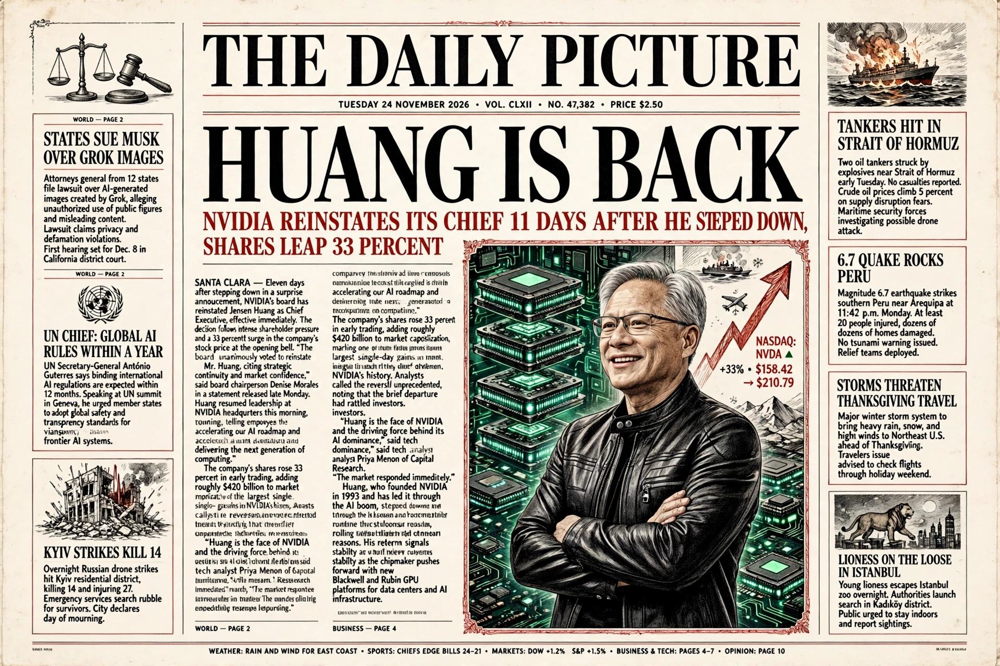

# The Daily Picture — Tuesday 24 November 2026

[](https://make.fun/bounty/news-image-20261124)
[](https://make.fun/bounty/news-image-20261124)
[](https://make.fun/bounty/news-image-20261124)

One image summing up the world news of Tuesday 24 November 2026, drawn as a
broadsheet newspaper front page for the [make.fun](https://make.fun/bounty/news-image-20261124)
news-image competition.



## What is on the page

- **Lead story — Huang is back.** Eleven days after Jensen Huang stepped
  down as Nvidia's chief executive amid a "spy" controversy, the board
  reinstated him, effective immediately. President Donald Trump claimed a
  role in the reversal and posted about it on Truth Social, and the
  company's shares leapt 33 percent — roughly $420 billion of market value
  in a single session. The front page's portrait shows Huang in his
  signature leather jacket in front of a wall of glowing green AI chips,
  with the day's chart arrowing up beside him.
- **States sue Musk over Grok images.** Several US states sued Elon Musk's
  companies over sexualised images generated by the Grok AI chatbot,
  alleging privacy and defamation violations.
- **UN chief: global AI rules within a year.** UN Secretary-General
  António Guterres called for a global AI risk-management framework to be
  in place within a year, urging member states to adopt binding safety
  and transparency standards for frontier AI systems.
- **Kyiv strikes kill 14.** Overnight Russian strikes on the Kyiv region
  killed at least 14 people, as President Volodymyr Zelensky called for
  four-way talks with Russia "as soon as possible".
- **Tankers hit in Hormuz.** Oil tankers were struck in the Strait of
  Hormuz, pushing crude prices up on supply-disruption fears.
- **6.7 quake rocks Peru.** A magnitude 6.7 earthquake struck Peru; no
  deaths were reported.
- **Storms threaten Thanksgiving travel.** Storms and airline glitches
  threatened a messy Thanksgiving travel week in the United States, with
  flood watches on the West Coast.
- **Lioness on the loose in Istanbul.** Turkish authorities searched for
  a lioness spotted on the outskirts of Istanbul.

## How to run it

The program is Python 3.13, standard library only. It copies `entry.png`
byte-for-byte to the output directory and then verifies the copy's size
and SHA-256 hash against the source:

```sh
mkdir -p out && MAKEFUN_OUTPUT_DIR=out python3 main.py
```

Without `MAKEFUN_OUTPUT_DIR` it writes to `/output`, as the grader expects.
Running it twice produces byte-identical output.

## Files

- `entry.png` — the front-page image (1920 × 1280, 3,747,578 bytes)
- `main.py` — the entry program
- `LICENSE` — MIT
- `.makefun/owner.json` — payout wallet claim file
